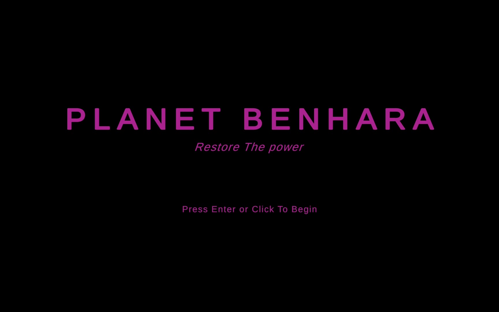

# Planet Benhara: Restore the Power

A first-person exploration game set on an alien planet, built solo in **Unity** with **C#**.

You wake up in your dome on Planet Benhara to find the power has failed. Explore the glowing landscape, track down five energy crystals and bring them back to restart the generator before the lights go out for good.

▶️ **[Watch the gameplay video](YOUR_YOUTUBE_LINK_HERE)**

---

## Gameplay

1. **Wake up at home.** Your dome's resident terminal shows a power failure: power at 3% and the generator offline.
2. **Explore Benhara.** Head out past the lake, the glowing forest and the crystal formations under a ringed-planet sky.
3. **Collect 5 energy crystals.** The on-screen counter tracks how many you've found and are carrying.
4. **Visit Momo**, your alien pet, who lives in a glass enclosure near the domes.
5. **Restart the generator.** Bring all five crystals back to power the colony and finish the game.

| | |
|---|---|
|  |  |
|  |  |

## Controls

| Key | Action |
|---|---|
| W A S D | Move |
| Mouse | Look around |
| Shift | Run |
| Space | Jump |
| E | Interact (open doors, inspect, pick up) |

## Features

- **First-person controller** with walking, running and jumping
- **Collect-and-deliver objective** with a live HUD counter and on-screen messages
- **Context-sensitive interactions**: `[E] Open` and `[E] Inspect` prompts on doors, screens and objects
- **Holographic in-world UI**: a resident terminal that shows the colony's status, and a map of points of interest
- **Pet character (Momo)** with its own interaction
- **Hand-built environment**: sculpted terrain, a lake, glowing alien plants, crystal formations, a starry sky with a ringed planet, and stylised lighting and fog
- **Title screen and ending** that frame the game as one complete loop

## Built with

- Unity · C#
- [Add any packages or assets you used, e.g. Unity Terrain Tools, TextMesh Pro, ProBuilder]

## How to run

**Play the build:** download the latest build from [Releases](../../releases) and run `PlanetBenhara.exe`.

**Open the project:**
1. Clone this repository.
2. Open the folder in Unity Hub with Unity **[your version, e.g. 2022.3 LTS]**.
3. Open `Assets/Scenes/[YourMainScene].unity` and press Play.

## About

A solo project made for the *Virtual Reality, Games and Graphics* module (CS3VR) in my final year of BSc Computer Science at the University of Reading, 2026.

**Benjamin Vicente** · [LinkedIn](https://www.linkedin.com/in/benjamin-vicente-586290320/) · [GitHub](https://github.com/BenzaVic)

Third-party assets belong to their original creators. [List them here with links, or delete this line if everything is your own.]
