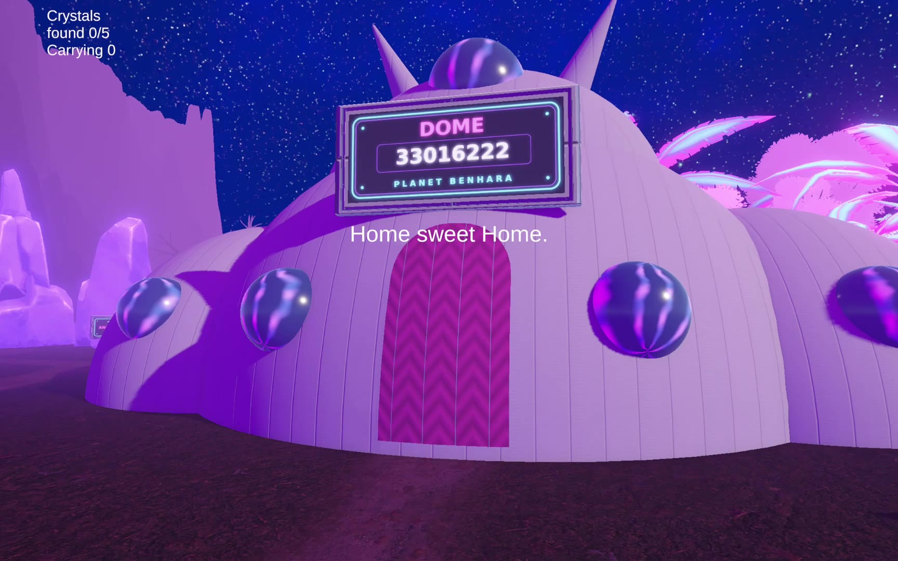
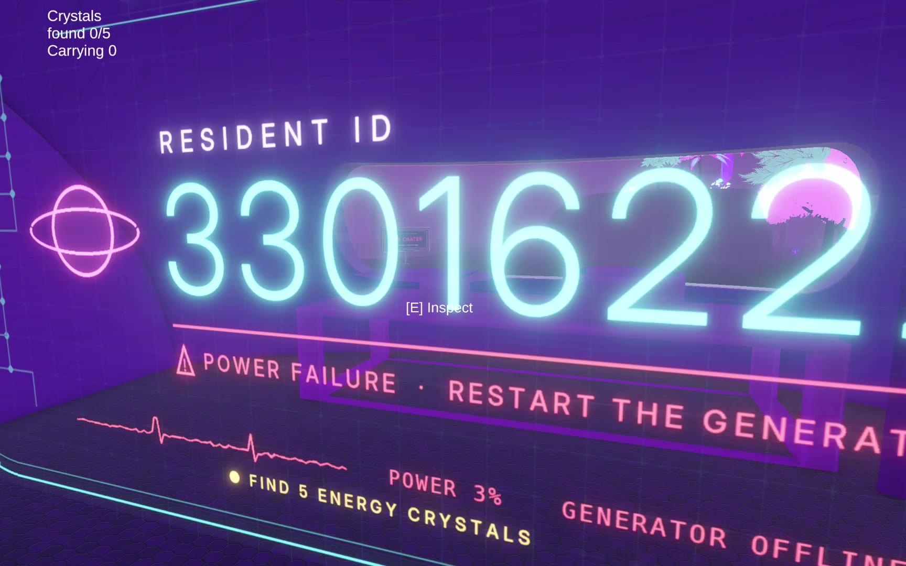
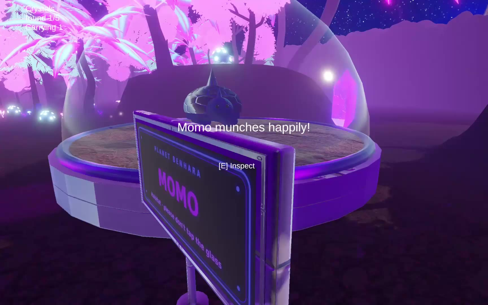
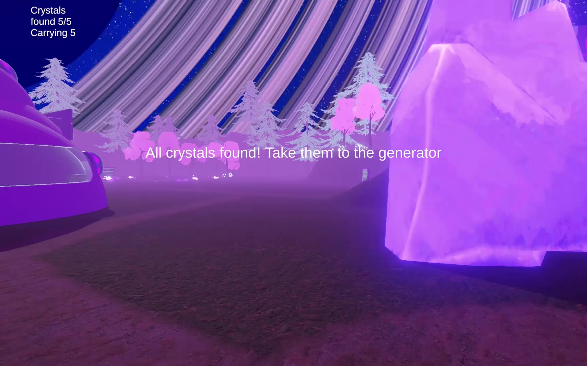
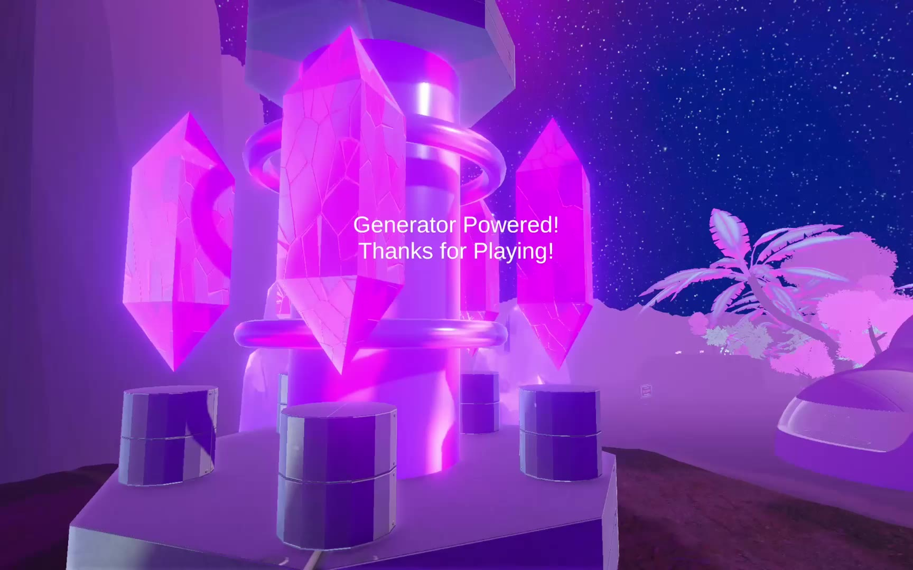

# Planet Benhara: Restore the Power

A first-person exploration game set on an alien planet, built solo in **Unity 6** with **C#**.

You wake up in your dome on Planet Benhara to find the power has failed. Explore the glowing landscape, track down five energy crystals and bring them back to restart the generator before the lights go out for good.

https://github.com/user-attachments/assets/e6fe28a4-5e6b-4659-86ca-21b7ffc2d19b

---

## Gameplay

1. **Wake up at home.** Your dome's resident terminal shows a power failure: power at 3% and the generator offline.
2. **Explore Benhara.** Head out past the lake, the glowing forest and the crystal formations under a ringed-planet sky.
3. **Collect 5 energy crystals.** The on-screen counter tracks how many you've found and are carrying.
4. **Feed Momo**, your alien pet, who lives in a glass enclosure near the domes.
5. **Restart the generator.** Bring all five crystals back to power the colony and finish the game.

| | |
|---|---|
|  |  |
|  |  |

## Controls

| Key | Action |
|---|---|
| W A S D | Move |
| Mouse | Look around |
| Shift | Run |
| Space | Jump |
| E | Interact (open doors, inspect, pick up, sit) |

## Features

- **First-person controller** with walking, running and jumping, built on Unity's Input System
- **Collect-and-deliver objective** with a live HUD counter and on-screen messages
- **Reusable interaction system**: any object with an `Interactable` component shows an `[E]` prompt and fires its own event, used for doors, drawers, seats, screens and the pet
- **Game-state-driven world**: the resident terminal switches between online and power-failure screens, and the generator dims the house lights, then powers them back up with sound and glow effects
- **Pet character (Momo)** you can feed
- **Hand-built environment**: sculpted terrain, an animated lake, glowing alien plants, crystal formations, a starry sky with a ringed planet, and stylised lighting, fog and post-processing
- **Title screen, intro sequence and ending** that make the game one complete loop

## Code

All gameplay scripts are in [`Assets/Scripts`](Assets/Scripts). Good places to start:

| Script | What it does |
|---|---|
| [`GameManager.cs`](Assets/Scripts/GameManager.cs) | Tracks crystals found and carried, updates the HUD and messages |
| [`Playerinteract.cs`](Assets/Scripts/Playerinteract.cs) | Raycasts from the camera, shows interaction prompts and triggers interactions |
| [`Interactable.cs`](Assets/Scripts/Interactable.cs) | Small reusable component: a prompt plus a `UnityEvent`, so new interactions need no new code |
| [`Generator.cs`](Assets/Scripts/Generator.cs) | Crystal sockets, power-down and power-up sequence, lights, glow and sound |
| [`TerminalScreen.cs`](Assets/Scripts/TerminalScreen.cs) | Swaps the holographic terminal between online and power-failure states |
| [`PlayerMovement.cs`](Assets/Scripts/PlayerMovement.cs) | First-person movement, running and jumping |

## Built with

- Unity 6 (6000.6.5f1) · C#
- Universal Render Pipeline (URP) · Post Processing
- Input System · TextMesh Pro · ProBuilder · AI Navigation

## How to run

1. Clone this repository.
2. Open the folder in Unity Hub with **Unity 6000.6.5f1**.
3. Open `Assets/Scenes/SampleScene.unity` and press Play.

Note: third-party Asset Store packs (furniture, books, trees, skybox and some props) are not included in this repository, because their licences don't allow redistribution. The project will open without them, but those objects will appear as missing.

## About

A solo project made for the *Virtual Reality, Games and Graphics* module (CS3VR) in my final year of BSc Computer Science at the University of Reading, 2026.

**Benjamin Vicente** · [LinkedIn](https://www.linkedin.com/in/benjamin-vicente-586290320/) · [GitHub](https://github.com/BenzaVic)
